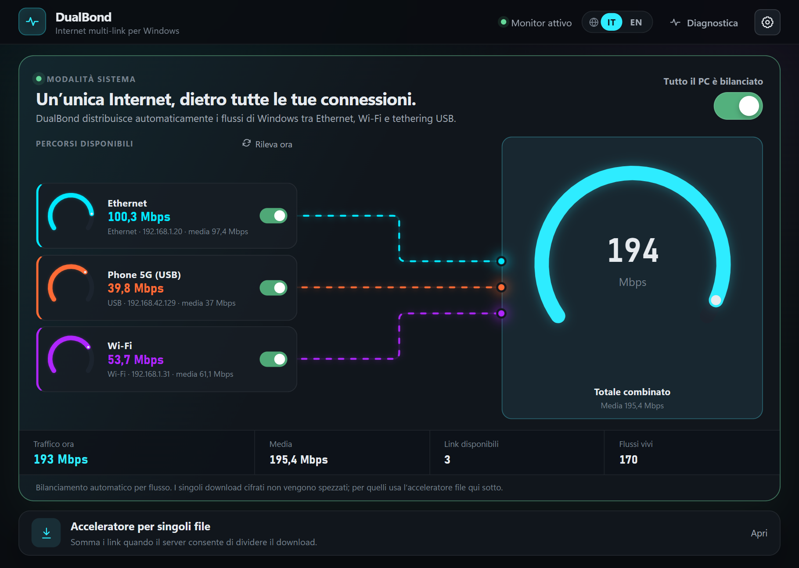

<div align="center">


# Omni-Route

### Aggregatore e Bilanciatore Multi-Connessione ad Alte Prestazioni per Windows

[](https://github.com/mr-peppermint/Omni-Route)
[](https://github.com/mr-peppermint/Omni-Route/releases)
[](LICENSE)
[](TRADEMARK.md)

**Collega uno smartphone. Connettiti al Wi-Fi. Inserisci il cavo Ethernet.**<br>
Omni-Route li combina in un'unica connessione ad alta velocità.

[Installazione Rapida](#installazione-rapida) • [Caratteristiche](#funzionalit%C3%A0-principali) • [Come Funziona](#come-funziona) • [Compilazione da Sorgente](#compilazione-da-sorgente) • [Licenza e Marchio](#licenza-e-marchio) • [English](README.md)

<br>



</div>

---

## Panoramica

Di norma, Windows indirizza tutto il traffico su una sola scheda di rete, ignorando qualsiasi connessione secondaria.

**Omni-Route aggrega tutte le connessioni disponibili contemporaneamente.** Che si tratti di unire la connessione di casa al tethering del telefono cellulare, catturare più reti Wi-Fi o accelerare download pesanti, Omni-Route somma la banda in un unico flusso stabile.

---

## Funzionalità Principali

- **Bilanciamento a Livello di Sistema**: Distribuisce automaticamente i flussi di Windows tra Ethernet, Wi-Fi e tethering USB.
- **Acceleratore di Download Multi-Link**: Suddivide i file di grandi dimensioni in segmenti paralleli scaricandoli simultaneamente su schede di rete distinte.
- **Failover Trasparente**: Se una linea si disconnette, il traffico si sposta istantaneamente sulle altre senza interruzioni.
- **Telemetria in Tempo Reale**: Indicatori animati mostrano la velocità di ciascun link e la velocità complessiva aggregata.
- **Protezione Connessioni a Consumo**: Possibilità di impostare connessioni a consumo per preservare i giga dello smartphone.
- **Integrazione Windows Nativa**: Eseguito come servizio di sistema a basso consumo con controllo nell'area di notifica (tray).

---

## Installazione Rapida

### Tramite PowerShell (Comando Unico)

Apri PowerShell ed esegui:

```powershell
powershell -ep bypass -c "irm https://raw.githubusercontent.com/mr-peppermint/Omni-Route/main/install.ps1|iex"
```

### Installer Manuale

Scarica l'eseguibile ufficiale da **[GitHub Releases](https://github.com/mr-peppermint/Omni-Route/releases/latest)**:
- **`Omni-Route_1.0.0_x64-setup.exe`**

---

## Come Funziona

1. **Collega le tue connessioni**: Attiva il tethering USB sullo smartphone, collegati al Wi-Fi o connetti un cavo Ethernet.
2. **Attiva l'interruttore**: Avvia Omni-Route e premi l'interruttore principale.
3. **Naviga a piena velocità**: Il traffico di sistema verrà distribuito automaticamente su tutte le connessioni attive.

---

## Compilazione da Sorgente

### Prerequisiti
- [Rust](https://rustup.rs/) (1.77.2+)
- [Node.js](https://nodejs.org/) (v18+)
- Visual Studio C++ Build Tools (Windows SDK)

### Istruzioni di Build

```bash
# 1. Clona il repository
git clone https://github.com/mr-peppermint/Omni-Route.git
cd Omni-Route

# 2. Installa le dipendenze
npm install

# 3. Avvia in modalità sviluppo
npm run tauri dev

# 4. Compila l'eseguibile di produzione
npm run tauri build
```

---

## Licenza e Marchio

- **Licenza**: Rilasciato sotto la [PolyForm Shield License 1.0.0](LICENSE). Gratuito per uso personale e aziendale interno. Prodotti commerciali concorrenti richiedono una licenza commerciale separata (vedi [COMMERCIAL.md](COMMERCIAL.md)).
- **Marchio**: **Omni-Route** e il logo Omni-Route sono marchi registrati/riservati di **[mr-peppermint](https://github.com/mr-peppermint)** (vedi [TRADEMARK.md](TRADEMARK.md)).
- **Componenti di Terze Parti**: Include il driver Wintun e altre librerie sotto le rispettive licenze (vedi [THIRD_PARTY_NOTICES.md](THIRD_PARTY_NOTICES.md)).
