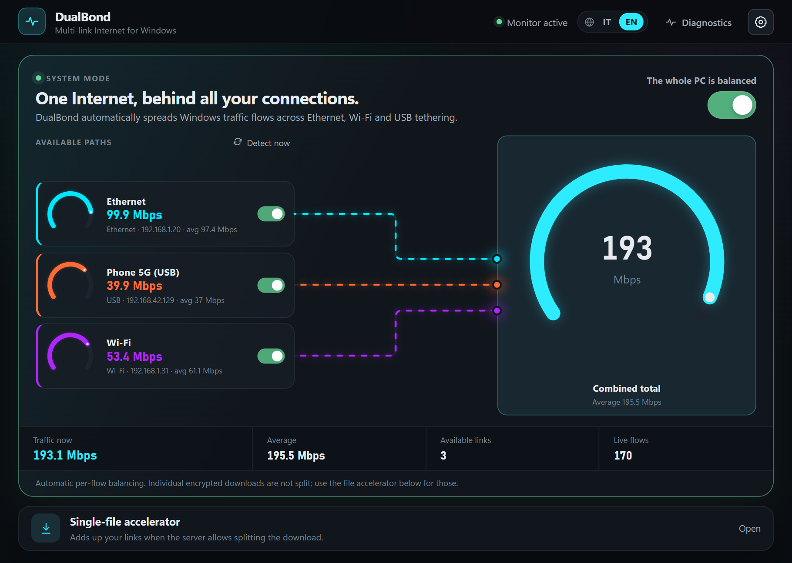

<div align="center">


# Omni-Route

### High-Performance Multi-Link Internet Aggregator for Windows

[](https://github.com/mr-peppermint/Omni-Route)
[](https://github.com/mr-peppermint/Omni-Route/releases)
[](LICENSE)
[](TRADEMARK.md)

**Plug in a phone. Join a Wi-Fi. Plug in an Ethernet cable.**<br>
Omni-Route bonds them together into a single, high-speed connection.

[Quick Install](#quick-install) • [Key Features](#key-features) • [How It Works](#how-it-works) • [Build from Source](#building-from-source) • [License & Trademark](#license--trademark) • [Italiano](README.it.md)

<br>



</div>

---

## Overview

Windows normally routes all network traffic through a single adapter, completely ignoring secondary connections.

**Omni-Route aggregates all available network connections simultaneously.** Whether combining home broadband with USB phone tethering, pooling multiple Wi-Fi networks, or accelerating large downloads across separate physical pipes, Omni-Route combines your bandwidth into one unified, resilient stream.

```
+-------------+       +---------------+
| Ethernet    | --->  |               |
+-------------+       |  Omni-Route   | ---> Total Aggregated Bandwidth
| Wi-Fi       | --->  |  Core Engine  |      (e.g., 50 + 25 + 25 = 100 Mbps)
+-------------+       |               |
| USB Tether  | --->  |               |
+-------------+       +---------------+
```

---

## Key Features

- **System-Wide Load Balancing**: Spreads active Windows traffic flows across Ethernet, Wi-Fi, and USB cellular adapters automatically.
- **Multi-Link Download Accelerator**: Splits large files into parallel segments and retrieves them simultaneously across different network paths.
- **Zero-Downtime Failover**: If any connection drops, active traffic instantly shifts to surviving links without losing your session.
- **Real-Time Telemetry**: Animated live gauges show the speed contributed by each link alongside aggregate throughput.
- **Metered Link Protection**: Mark cellular or data-capped links as metered to prevent excessive mobile data usage.
- **Native Windows Integration**: Operates as an automated background Windows service with system tray controls and seamless startup.

---

## Quick Install

### One-Line Install (PowerShell)

Open PowerShell and run:

```powershell
powershell -ep bypass -c "irm https://raw.githubusercontent.com/mr-peppermint/Omni-Route/main/install.ps1|iex"
```

### Manual Installer

Download the official setup executable from **[GitHub Releases](https://github.com/mr-peppermint/Omni-Route/releases/latest)**:
- **`Omni-Route_1.0.0_x64-setup.exe`**

---

## How It Works

1. **Connect your adapters**: Plug in a phone with USB tethering, connect to a Wi-Fi network, or plug in Ethernet.
2. **Toggle the switch**: Open Omni-Route and flip the master switch.
3. **Enjoy aggregated speed**: Windows traffic will automatically flow across all active connections.

---

## Building from Source

### Prerequisites
- [Rust](https://rustup.rs/) (1.77.2+)
- [Node.js](https://nodejs.org/) (v18+)
- Visual Studio C++ Build Tools (Windows SDK)

### Build Instructions

```bash
# 1. Clone repository
git clone https://github.com/mr-peppermint/Omni-Route.git
cd Omni-Route

# 2. Install frontend dependencies
npm install

# 3. Run development build
npm run tauri dev

# 4. Build production installer
npm run tauri build
```

---

## License & Trademark

- **License**: Released under the [PolyForm Shield License 1.0.0](LICENSE). Free for personal, academic, and internal workplace use. Commercial competing products require a separate commercial license (see [COMMERCIAL.md](COMMERCIAL.md)).
- **Trademark**: **Omni-Route** and the Omni-Route logo are trademarks owned by **[mr-peppermint](https://github.com/mr-peppermint)** (see [TRADEMARK.md](TRADEMARK.md)).
- **Third-Party Notices**: Includes components such as the Wintun driver under their respective licenses (see [THIRD_PARTY_NOTICES.md](THIRD_PARTY_NOTICES.md)).
